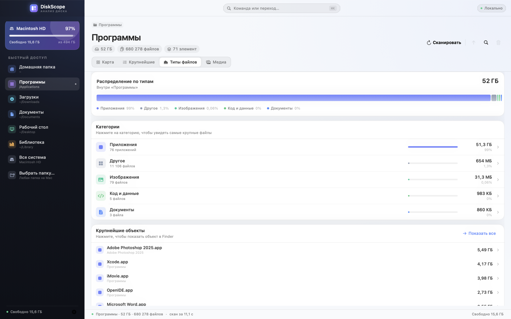
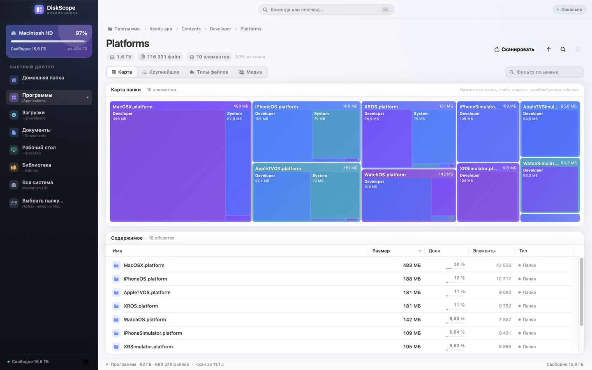
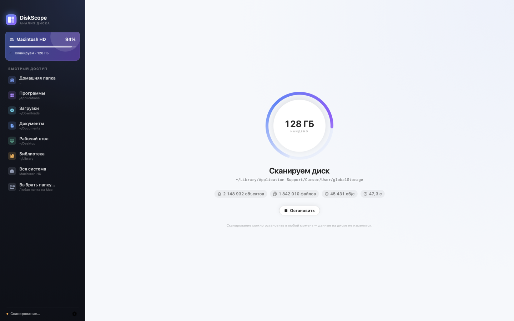
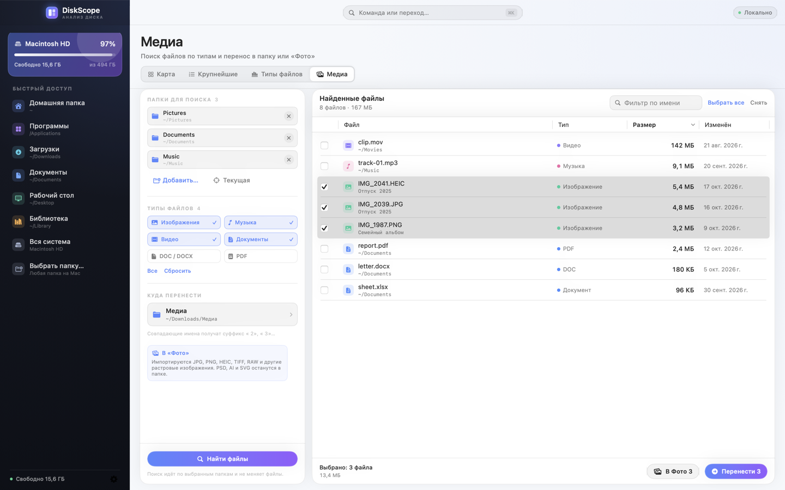
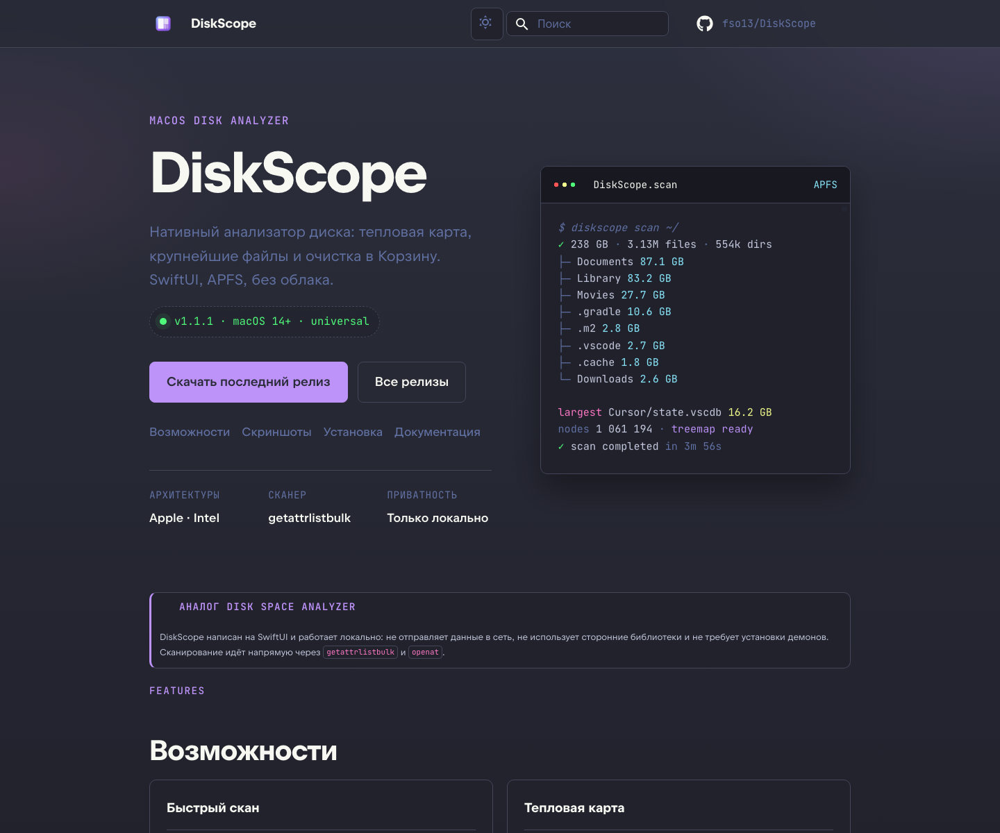

# DiskScope

Нативный анализатор диска для macOS — аналог Disk Space Analyzer / DaisyDisk.
Показывает, что именно занимает место: тепловая карта папок, крупнейшие файлы,
распределение по типам и очистка в Корзину прямо из приложения.

[Скачать последний релиз](https://github.com/fso13/DiskScope/releases/latest) · [Сайт документации](https://fso13.github.io/DiskScope/) · [Репозиторий](https://github.com/fso13/DiskScope)


📖 Подробная документация: [docs/index.md](docs/index.md). Опубликованный сайт —
https://fso13.github.io/DiskScope/.

## Возможности

- **Быстрый скан** через `getattrlistbulk` и `openat`: один системный вызов на
  пачку файлов, без обхода по строкам путей. На тёплом кэше — до ~170 000
  объектов в секунду.
- **Тепловая карта (treemap)** в два уровня: размер прямоугольника = место на
  диске. Клик по папке открывает её, внутри крупных папок видны вложенные
  элементы. Цвет — по типу содержимого.
- **Крупнейшие объекты**: файлы и приложения, отсортированные по размеру, с
  путём и быстрыми действиями.
- **Типы файлов**: видео, изображения, аудио, архивы, документы, код,
  приложения — с размерами, количеством и переходом к файлам категории.
- **Медиа-поиск**: изображения, музыка, видео и документы (DOC/DOCX, PDF) по
  нескольким папкам; выбор файлов и перенос в выбранную папку или «Фото».
- **Очистка**: «Показать в Finder» и «Переместить в Корзину» с подтверждением.
  После удаления дерево и все суммы обновляются сразу, без полного перескана.
- **Безопасность**: приложение читает только метаданные. Пишет оно лишь
  настройку «последняя папка» в UserDefaults и перемещает выбранные объекты в
  Корзину, выбранную папку или «Фото» — и только по явному подтверждению.
- **Полностью локально**: нет сетевых запросов, телеметрии и сторонних
  зависимостей.
- **Кастомное окно**: title bar с нативными traffic lights, статусом и
  командной палитрой (`⌘K`).
- Поддержка светлой и тёмной темы, русского интерфейса, клавиатурных сокращений.

| Крупнейшие | Типы файлов |
| --- | --- |
|  |  |

| Вложенная карта | Сканирование |
| --- | --- |
|  |  |

## Медиа-поиск

После первого сканирования откройте вкладку «Медиа» (⌘4): она ищет
изображения, музыку, видео и документы (DOC/DOCX, PDF) в произвольных папках. Найденные файлы можно отметить по одному или все
сразу, перенести в выбранную папку, а изображения — импортировать в «Фото» с
перемещением оригиналов.



Поиск не зависит от текущего скана: источники — отдельный список папок.
Скрытые файлы, содержимое пакетов и симлинки пропускаются. При совпадении имён
добавляется суффикс « 2», « 3»…; для импорта в «Фото» macOS запросит доступ.

## Установка

Требуется macOS 14+ и Xcode 15+ (проект собирается Swift Package Manager).

Готовую universal-сборку (Apple Silicon + Intel) можно скачать в
[последнем релизе](https://github.com/fso13/DiskScope/releases/latest) или по
[прямой ссылке](https://github.com/fso13/DiskScope/releases/latest/download/DiskScope-macos-universal.dmg).

DMG — кастомный установщик с фирменным фоном: откройте образ, перетащите
`DiskScope.app` в «Программы» и запустите приложение.

```bash
./build.sh
open dist/DiskScope.dmg
```

Скрипт создаёт `dist/DiskScope.app`, `dist/DiskScope.dmg` и `dist/DiskScope.zip`.
Для установки откройте DMG и перетащите `DiskScope.app` в «Программы». Приложение
подписано ad-hoc; при первом запуске macOS может попросить подтверждение —
«Открыть» через контекстное меню.

Для universal-сборки (Apple Silicon + Intel), как в релизах:

```bash
VERSION=1.1.1 BUILD_NUMBER=1 UNIVERSAL=1 ./build.sh
```

`VERSION` и `BUILD_NUMBER` подставляются в `Info.plist`; в CI версия берётся из
тега. Готовые релизы публикуются автоматически (см. [CI и релизы](#ci-и-релизы)).

### Полный доступ к диску

Чтобы видеть защищённые папки (`~/Library/Mail`, `~/Library/Messages`,
`Photos Library`, чужие домашние папки и т. п.), выдайте приложению разрешение:

1. Сначала переместите `DiskScope.app` туда, где он будет жить (например, в
   «Программы»): разрешение macOS привязано к пути к приложению.
2. Откройте «Системные настройки → Конфиденциальность и безопасность →
   Полный доступ к диску».
3. Нажмите «+» и добавьте `DiskScope.app`.
4. Перезапустите DiskScope и повторите скан.

Без разрешения сканирование продолжится: недоступные объекты будут пропущены,
а в интерфейсе появится баннер с их количеством и списком.

## Как пользоваться


1. На стартовом экране выберите домашнюю папку, «Программы», весь диск или
   любую папку через `⌘O`.
2. Дождитесь окончания скана (его можно прервать) — появятся карта, список
   содержимого и статистика.
3. Кликайте по прямоугольникам, чтобы проваливаться в папки; хлебные крошки
   наверху подсказывают, где вы находитесь.
4. Откройте вкладку «Крупнейшие», чтобы найти самые большие файлы и
   приложения. Двойной клик — показать в Finder.
5. Выделите объекты в таблице и нажмите `⌘⌫`, чтобы переместить их в Корзину.

Основные сокращения:

| Действие | Клавиши |
| --- | --- |
| Сканировать снова | `⌘R` |
| Выбрать папку | `⌘O` |
| Наверх | `⌘↑` |
| Показать в Finder | `⇧⌘R` |
| В Корзину | `⌘⌫` |
| Карта / Крупнейшие / Типы | `⌘1` / `⌘2` / `⌘3` |

## Как это устроено

```
Sources/
  DiskScopeKit/
    Core/        сканер, дерево, форматирование, treemap-раскладка
    UI/          SwiftUI-интерфейс
    App/         AppModel — состояние, сканирование, действия
  DiskScope/     точка входа приложения
  DiskScopeCLI/  headless-сканер для замеров
  DiskScopeSnapshots/  рендер интерфейса в PNG без screen recording
Tests/           XCTest: сканер, дерево, раскладка, модель
Support/         Info.plist и генератор иконки
docs/            исходники сайта документации (MkDocs Material)
scripts/         release-notes.sh, sync-docs-assets.sh
.github/workflows/  release.yml и pages.yml
mkdocs.yml       конфигурация сайта
requirements-docs.txt  Python-зависимости документации
CHANGELOG.md     история версий для release notes
build.sh         release-сборка, иконка, подпись, zip
```

- **Сканер.** Рекурсивный обход на файловых дескрипторах: `openat` для каждого
  каталога, `getattrlistbulk` с атрибутами `ATTR_FILE_ALLOCSIZE`,
  `ATTR_DIR_ALLOCSIZE`, `ATTR_DIR_MOUNTSTATUS`. Точки монтирования не
  пересекаются, симлинки не разыменовываются. Для файловых систем без
  `getattrlistbulk` есть запасной путь `readdir + fstatat`.
- **Дерево.** Плоские массивы `ScanNode` и общий UTF-8-блоб имён: миллионы
  узлов занимают десятки мегабайт, а не гигабайты. Файлы меньше 64 КБ
  агрегируются по папкам («Мелкие файлы»); суммы при этом точные.
  Пакеты `.app` считаются одним объектом для очистки, но сканируются внутри
  для точного размера.
- **Удаление.** Дерево не мутируется: после перемещения в Корзину создаётся
  копия с вырезанными поддеревьями (copy-on-write), поэтому фоновые
  вычисления статистики не гоняются с изменениями.
- **Treemap.** Squarified-раскладка (Bruls, Huizing, van Wijk), два уровня,
  полоса с именем родителя, адаптивный цвет текста для светлых категорий.

## Документация

- [Обзор](docs/index.md)
- [Как пользоваться](docs/usage.md)
- [Сборка и тесты](docs/build.md)
- [Архитектура](docs/architecture.md)
- [CI и релизы](docs/release.md)
- [Ограничения](docs/limitations.md)

Опубликованный сайт: [https://fso13.github.io/DiskScope/](https://fso13.github.io/DiskScope/)



Локально сайт поднимается так:

```bash
python3 -m venv .venv
.venv/bin/pip install -r requirements-docs.txt
.venv/bin/mkdocs serve
```

После изменения скриншотов выполните `./scripts/sync-docs-assets.sh`.

## CI и релизы

- [release.yml](.github/workflows/release.yml) — по тегу `v*`: тесты,
  universal-сборка, артефакт workflow и GitHub Release с описанием из
  [CHANGELOG.md](CHANGELOG.md), прямыми ссылками на DMG/ZIP и страницу
  релиза, `SHA256SUMS.txt` и постоянным DMG-образом
  `DiskScope-macos-universal.dmg` (плюс ZIP-архив).
- [pages.yml](.github/workflows/pages.yml) — сборка [mkdocs.yml](mkdocs.yml) из
  [docs/](docs/index.md) и деплой на GitHub Pages.

Выпуск релиза:

```bash
git tag -a v1.1.1 -m "DiskScope 1.1.1"
git push origin v1.1.1
```

Для GitHub Pages один раз включите **Settings → Pages → Source: GitHub Actions**
(встроенный `GITHUB_TOKEN` не может сделать это автоматически). Адрес сайта —
https://fso13.github.io/DiskScope/.

Прямая ссылка на последний стабильный релиз:
https://github.com/fso13/DiskScope/releases/latest/download/DiskScope-macos-universal.dmg

Подробности, права токена и диагностика — в [docs/release.md](docs/release.md).

## Разработка

```bash
swift build
swift test
```

Headless-сканер для бенчмарков:

```bash
.build/debug/diskscope-cli /Applications
.build/debug/diskscope-cli --min-size 0 --limit 20 ~/Library
```

Пересобрать PNG-снимки интерфейса (без разрешения на запись экрана):

```bash
.build/debug/DiskScopeSnapshots snapshots /Applications
```

В этом окружении SwiftPM запускается с `--disable-sandbox` и отдельным кэшем
модулей — см. `build.sh`; на обычной машине достаточно `swift build`.

## Тесты

23 теста: сравнение суммы скана с `du`, агрегация мелких файлов, пакеты,
симлинки, Unicode-имена, отказ доступа, отмена, copy-on-write удаление,
свойства squarified-раскладки, вложенные ячейки, полный цикл `AppModel`
(скан → навигация → фильтры).

```bash
swift test
```

## Ограничения

- Жёсткие ссылки (hardlinks) считаются по каждому пути, а не один раз, как это
  делает `du`. В пользовательских данных встречаются редко.
- Снимки APFS и «вытесняемые» (purgeable) блоки не показываются отдельно;
  свободное место берётся из `statfs`. Клоны APFS считаются как обычные файлы
  (так же, как `du`).
- Файлы меньше 64 КБ не показываются по отдельности — они собраны в «Мелкие
  файлы» внутри папки.
- Приложения (.app) в рейтинге и корзине участвуют как один объект.
- Интерфейс на русском языке.
- Нет поиска дубликатов — это возможное следующее расширение.

## Лицензия

MIT. См. [LICENSE](LICENSE).
