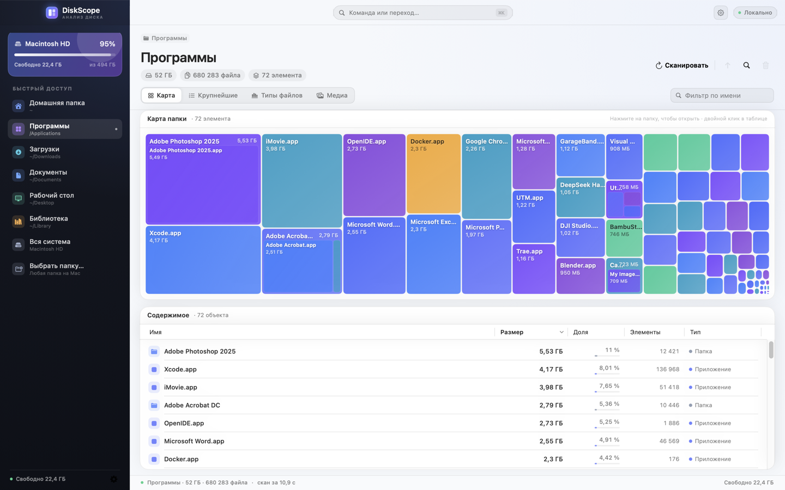
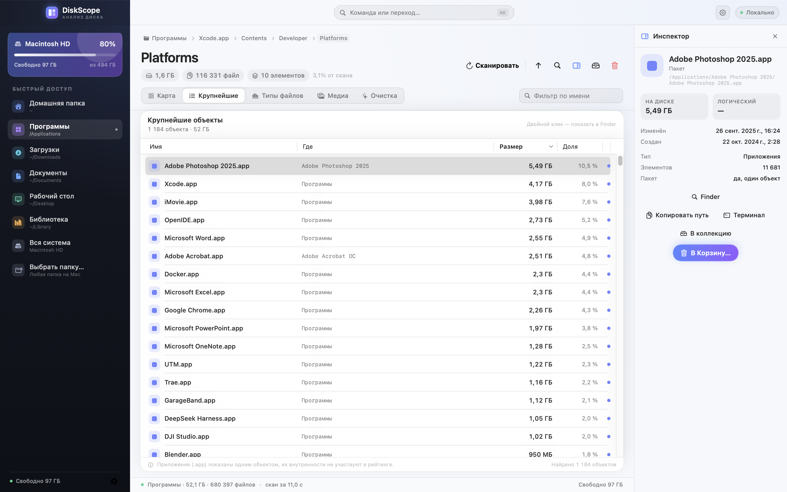

---
hide:
  - navigation
  - toc
---

<section class="hero" aria-label="DiskScope">

macOS disk analyzer

<h1 class="hero-name">DiskScope</h1>

Нативный анализатор диска: тепловая карта, крупнейшие файлы и очистка в Корзину. SwiftUI, APFS, без облака.

v1.1.1 · macOS 14+ · universal

<a class="btn btn-primary" href="https://github.com/fso13/DiskScope/releases/latest/download/DiskScope-macos-universal.dmg">Скачать последний релиз</a>
<a class="btn btn-ghost" href="https://github.com/fso13/DiskScope/releases">Все релизы</a>

<nav class="hero-nav" aria-label="Разделы">
<a href="#features">Возможности</a>
<a href="#screenshots">Скриншоты</a>
<a href="#install">Установка</a>
<a href="usage.html">Документация</a>
</nav>

Архитектуры<strong>Apple · Intel</strong>

Сканер<strong>getattrlistbulk</strong>

Приватность<strong>Локально</strong>

<aside class="hero-panel" aria-hidden="true">

DiskScope.scan
APFS

<pre class="hero-code"><code>$ diskscope scan ~/
✓ 238 GB · 3.13M files · 554k dirs
├─ Documents 87.1 GB
├─ Library 83.2 GB
├─ Movies 27.7 GB
├─ .gradle 10.6 GB
├─ .m2 2.8 GB
├─ .vscode 2.7 GB
├─ .cache 1.8 GB
└─ Downloads 2.6 GB
 
largest Cursor/state.vscdb 16.2 GB
nodes 1 061 194 · treemap ready
✓ scan completed in 3m 56s</code></pre>
</aside>
</section>

!!! info "Аналог Disk Space Analyzer"
    DiskScope написан на SwiftUI и анализирует диск локально: файлы и
    результаты не отправляются в сеть. Сеть используется только для проверки
    обновлений по кнопке в настройках. Сторонних библиотек и демонов нет.
    Сканирование идёт напрямую через `getattrlistbulk` и `openat`.

Features

## Возможности {#features}

-   **Быстрый скан**

    ---

    Один системный вызов на пачку файлов, обход на файловых дескрипторах,
    прогресс и отмена. На тёплом кэше — до ~170 000 объектов/с.

-   **Drag & drop**

    ---

    Перетащите папку в окно — скан начнётся сразу. Файл открывает свою папку.

-   **Тепловая карта**

    ---

    Два уровня treemap: размер прямоугольника равен месту на диске. Клик
    проваливает в папку, у больших папок видны вложенные элементы.

-   **Крупнейшие файлы**

    ---

    Файлы и приложения, отсортированные по размеру, с путём, долей и быстрыми
    действиями в Finder или Корзину.

-   **Типы и очистка**

    ---

    Видео, изображения, аудио, архивы, документы, код и приложения. Удаление —
    только по подтверждению, с мгновенным пересчётом дерева.

-   **Очистка по правилам**

    ---

    Кэши Xcode, старые установщики, бэкапы и Docker. Риск, цель по гигабайтам
    и отмена через `⌘Z`.

-   **Экспорт отчёта**

    ---

    CSV или HTML по текущей папке либо всему скану. Учитывает поиск и фильтры;
    HTML — один файл с топ-100.

-   **Коллекция**

    ---

    Кандидаты на удаление из разных папок в одном списке. `⌘`-клик на карте,
    `⌘6` — панель, удаление пачкой с отменой.

-   **Глобальный поиск**

    ---

    `⌘F` по имени или части пути, с фильтрами размера, типа, категории и даты.
    Индекс строится локально и только при первом открытии.

-   **Инспектор и QuickLook**

    ---

    `⌥⌘I` — путь, занятый и логический размер, даты. `Пробел` — быстрый
    просмотр; контекстные меню ведут в Finder, терминал и коллекцию.

-   **Медиа-поиск**

    ---

    Изображения, музыка, видео и документы (DOC/DOCX, PDF) по нескольким
    папкам. Выбор файлов и перенос в выбранную папку.

-   **В «Фото»**

    ---

    Выбранные изображения можно импортировать в медиатеку «Фото»;
    оригиналы перемещаются, а не копируются.

-   **Командная палитра**

    ---

    Все действия — скан, переходы, Finder, Корзина и настройки — через `⌘K`.

-   **Кастомное окно**

    ---

    Title bar с нативными traffic lights, статусом и командной палитрой —
    как в VS Code.

Install

## Установка {#install}

[Скачать последний релиз](https://github.com/fso13/DiskScope/releases/latest/download/DiskScope-macos-universal.dmg){ .md-button .md-button--primary }
[Все релизы](https://github.com/fso13/DiskScope/releases){ .md-button }

Universal DMG для Apple Silicon и Intel, macOS 14+. Откройте образ с фирменным
фоном и перетащите `DiskScope.app` в «Программы». Подпись ad-hoc: при первом
запуске может понадобиться «Открыть» через контекстное меню.

1. Скачайте `DiskScope-macos-universal.dmg` и откройте образ.
2. Перетащите `DiskScope.app` в «Программы».
3. Для полного сканирования выдайте приложению «Полный доступ к диску» и
   перезапустите его.

Или соберите сами: `./build.sh` — [Сборка и тесты](build.md).

Gallery

## Скриншоты {#screenshots}

<figure>

<figcaption>Тепловая карта</figcaption>
</figure>
<figure>

<figcaption>Крупнейшие объекты</figcaption>
</figure>
<figure>

<figcaption>Типы файлов</figcaption>
</figure>
<figure>

<figcaption>Вложенная карта</figcaption>
</figure>
<figure>

<figcaption>Очистка по правилам</figcaption>
</figure>
<figure>

<figcaption>Инспектор и быстрый просмотр</figcaption>
</figure>

Releases

## Что нового {#releases}

Текущий релиз — **v1.1.1**. [Все релизы](https://github.com/fso13/DiskScope/releases) ·
[CHANGELOG](https://github.com/fso13/DiskScope/blob/main/CHANGELOG.md).

DiskScope сканирует диск локально, показывает карту и крупнейшие объекты,
считает типы файлов и умеет аккуратно перемещать выбранное в Корзину. Релизы
собираются автоматически по тегам, а этот сайт — из тех же Markdown-файлов.

License

## Лицензия {#license}

MIT. Исходный код — в репозитории [fso13/DiskScope](https://github.com/fso13/DiskScope).
