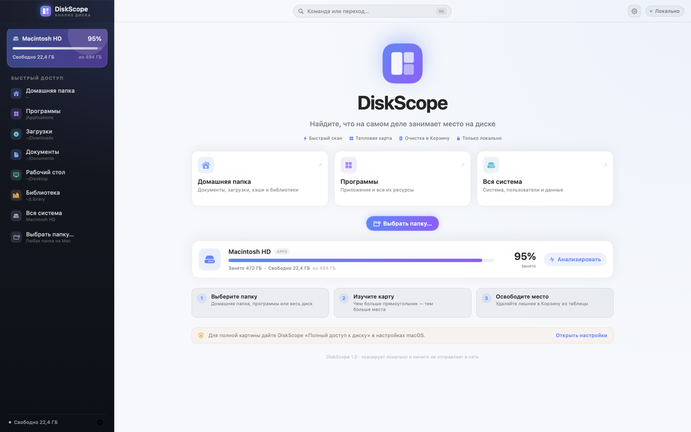
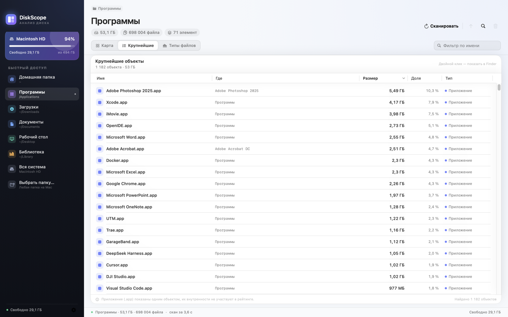
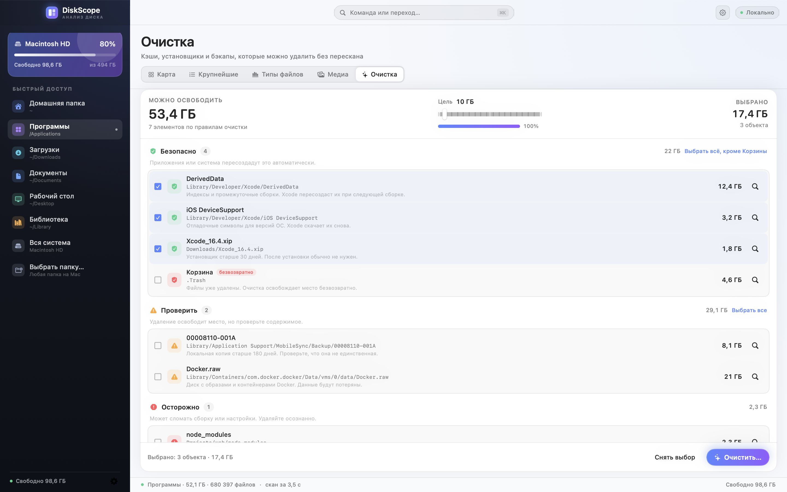

Guide

# Как пользоваться

!!! tip "Установка"
    Скачайте [DMG-установщик](https://github.com/fso13/DiskScope/releases/latest/download/DiskScope-macos-universal.dmg),
    откройте образ, перетащите `DiskScope.app` в «Программы» и запустите.
    Или соберите приложение по инструкции в разделе [Сборка и тесты](build.md).

## 1. Выберите папку

На стартовом экране доступны быстрые варианты:

- **Домашняя папка** — документы, загрузки, кэши и библиотеки;
- **Программы** — `/Applications` и все ресурсы приложений;
- **Вся система** — весь диск, включая системные каталоги.

Любую другую папку можно выбрать через `⌘O`, пункт «Выбрать папку…» или просто
перетащить её в окно. Приложение посчитает размеры и покажет карту, содержимое
текущей папки и статистику.

## 2. Изучите карту

Каждый прямоугольник — файл или папка. Чем больше площадь, тем больше места
объект занимает на диске.

- **Клик по папке** — открыть её; хлебные крошки наверху показывают путь.
- **Наведение** — подсказка с именем, размером и долей.
- **Вложенные прямоугольники** — содержимое крупных папок; у больших ячеек
  сверху есть полоса с именем родителя.
- **Двойной клик в таблице** — открыть папку или показать файл в Finder.

## 3. Найдите крупнейшее

Вкладка **«Крупнейшие»** содержит файлы и приложения, отсортированные по
размеру. Приложения `.app` показываются одним объектом: их внутренние файлы не
участвуют в рейтинге и не предлагаются к удалению по отдельности.

Вкладка **«Типы файлов»** показывает распределение по категориям. Нажмите на
категорию, чтобы увидеть её самые крупные файлы.

## 4. Освободите место

Выделите объекты в таблице (можно несколько, с `⌘` или `⇧`) и нажмите `⌘⌫`.
Приложение спросит подтверждение и переместит выбранное в Корзину.

- **«Показать в Finder»** (`⇧⌘R`) — открыть выбранное или текущую папку.
- **«Переместить в Корзину»** (`⌘⌫`) — безопасное удаление с возможностью
  восстановления.
- **«Отменить удаление»** (`⌘Z`) — вернуть последнюю пачку файлов из Корзины и
  восстановить дерево. Если исходный путь уже занят, файл останется в Корзине,
  а приложение покажет ошибку.
- После удаления размеры, карта и рейтинги обновляются сразу, без полного
  перескана.

!!! warning "Что нельзя удалить из приложения"
    Строка «Мелкие файлы» — это агрегат из сотен файлов меньше 64 КБ. Она
    показывает место, но не предлагает удаление. Чтобы разобраться с мелкими
    файлами, откройте папку в Finder.

## 5. Очистка по правилам

Вкладка **«Очистка»** (`⌘5`) показывает, что можно освободить по известным
правилам: кэши Xcode, старые установщики, бэкапы iPhone, Docker, Gradle, Maven,
npm и `node_modules`.

- Рекомендации сгруппированы по риску: **Безопасно**, **Проверить**,
  **Осторожно**. Безопасные выбраны сразу, остальные — вручную.
- Ползунок «Цель» показывает, сколько осталось до нужного объёма.
- Кнопка **«Очистить…»** перемещает выбранное в Корзину и показывает, сколько
  освободилось. Вернуть файлы можно через `⌘Z`.
- **Корзина** не выбирается по умолчанию и очищается безвозвратно — это
  единственное правило, которое нельзя отменить.

Полная таблица правил и условий — в [Правилах очистки](cleanup-rules.md).

## Медиа-поиск

Вкладка **«Медиа»** (`⌘4`) появляется после первого сканирования и ищет файлы
по типам в отдельных папках. Найденное можно перенести в выбранную папку или
в «Фото».

1. Откройте вкладку «Медиа» и добавьте одну или несколько папок. Текущая
   папка скана подставляется автоматически, если список пуст.
2. Отметьте типы: изображения, музыка, видео, документы, DOC/DOCX или PDF.
3. Нажмите **«Найти файлы»**. Поиск можно отменить.
4. Отметьте файлы чекбоксами или кнопкой **«Выбрать все»**.
5. Выберите папку назначения и нажмите **«Перенести»**. Для изображений
   доступна кнопка **«В Фото»**.

!!! warning "Оригиналы"
    При импорте в «Фото» оригиналы перемещаются в медиатеку. Проверьте выбор
    перед подтверждением: операция меняет файлы на диске.

- Поиск не зависит от текущего скана и идёт по списку папок.
- Скрытые файлы, содержимое пакетов и симлинки пропускаются.
- Совпадающие имена получают суффикс « 2», « 3»….
- Показывается не больше 25 000 результатов — уточните папки или типы.
- В «Фото» импортируются растровые форматы (JPG, PNG, HEIC, TIFF, RAW и
  другие). PSD, AI и SVG останутся в папке.
- Для импорта в «Фото» разрешите DiskScope доступ в
  **«Системные настройки → Конфиденциальность и безопасность → Фото»**.

## Глобальный поиск

Нажмите **`⌘F`**, чтобы искать по всему текущему скану, а не только по открытой
папке. Индекс имён строится при первом открытии; для миллиона узлов это
занимает около секунды и происходит в фоне.

- Ищите по имени или части пути (`Library/Caches`).
- Фильтры: размер, тип (файлы/папки/пакеты), категория и дата изменения.
- Сортировка: по размеру, имени или дате.
- Двойной клик или стрелка ведёт к папке объекта; доступны Finder, коллекция и
  Корзина. `Esc` закрывает поиск.
- Содержимое пакетов не индексируется: `.app` находится как один объект.

## Инспектор и быстрый просмотр

Инспектор открывается по `⌥⌘I`, кнопкой `sidebar.right` в заголовке или из
палитры команд. Он показывает выбранный объект: путь, занятый и логический
размер, даты, категорию и количество элементов. Логический размер читается
точечно из файловой системы, поэтому не замедляет скан.

- **Пробел** или `⌘Y` открывает QuickLook для выбранного файла.
- Для папки или пакета быстрый просмотр недоступен.
- Контекстные меню в «Содержимом», «Крупнейших», «Типах» и на карте:
  Finder, копировать путь, терминал, коллекция и Корзина.

## Диск

Вкладка **«Диск»** (`⌘7`) показывает полную картину внутреннего тома:

- занятое и свободное место, оценку **purgeable** — сколько macOS может
  освободить без удаления ваших файлов;
- размер и количество объектов в **Корзине**; кнопка «Открыть Корзину» ведёт в
  Finder;
- локальные **снимки APFS** Time Machine. Список читается через `tmutil`;
  размер снимков система не отдаёт, и DiskScope их не удаляет.

Данные обновляются кнопкой «Обновить»; корзина и снимки считаются в фоне.
Если `tmutil` недоступен, вместо пустого списка появится предупреждение.

## История сканов

`⌘8` открывает историю последних 30 сканов. Каждый успешный скан сохраняется
локально в `~/Library/Application Support/DiskScope/scan-history.json`.

- Выберите скан слева — справа появится сравнение с **текущим** деревом:
  общий прирост, изменение числа файлов и папки верхнего уровня, которые
  выросли или уменьшились.
- Сравнение работает только для той же корневой папки. Для другой папки
  появится предупреждение.
- «Сканировать снова» запускает скан выбранного пути, «Удалить запись» убирает
  одну точку, «Очистить историю» — все.
- Сами файлы история не трогает; это только метаданные.

## Коллекция

Коллекция нужна, когда кандидаты на удаление разбросаны по разным папкам.

- В таблице «Содержимое» или «Крупнейшие» откройте контекстное меню и выберите
  **«В коллекцию»**.
- На карте нажмите **`⌘`** по ячейке или кнопку **«В коллекцию»** в карточке
  файла.
- Откройте коллекцию кнопкой с tray-иконкой, через `⌘6` или строку статуса.
- В панели можно показать объект в Finder, убрать его, очистить коллекцию или
  отправить всё в Корзину одним подтверждением. Отмена — `⌘Z`.
- Вложенные объекты не дублируются: если добавлена папка, её содержимое в
  коллекцию не попадает. Коллекция сбрасывается при новом скане.

## Экспорт отчёта

Меню **«Файл → Экспортировать отчёт»** (`⇧⌘E`) сохраняет текущий скан в CSV
или HTML. Формат и охват выбираются в подменю: текущая папка или весь скан.

- **CSV** — путь, имя, размер в байтах, доля, категория, тип, дата изменения и
  количество элементов. Разделитель `;`, кодировка UTF-8 с BOM — файл
  открывается в Numbers и Excel.
- **HTML** — один самодостаточный файл: сводка, категории и топ-100 объектов.
  Внешние шрифты и сетевые ресурсы не используются.
- Поиск и фильтр категории учитываются: в отчёт попадает то, что видно сейчас.
- Данные не покидают Mac: отчёт формируется локально.

## Полный доступ к диску

Без разрешения macOS скрывает содержимое защищённых папок: `~/Library/Mail`,
`~/Library/Messages`, Photos Library, домашние папки других пользователей и
некоторые системные каталоги. DiskScope продолжит работу, но покажет баннер с
количеством пропущенных объектов.

1. Переместите `DiskScope.app` туда, где он будет постоянно лежать (например, в
   «Программы»): разрешение привязано к пути.
2. Откройте **Системные настройки → Конфиденциальность и безопасность →
   Полный доступ к диску**.
3. Нажмите **+**, добавьте `DiskScope.app` и включите переключатель.
4. Перезапустите DiskScope и повторите сканирование.

## Клавиатурные сокращения

| Действие | Клавиши |
| --- | --- |
| Сканировать снова | `⌘R` |
| Выбрать папку | `⌘O` |
| Наверх | `⌘↑` |
| Показать в Finder | `⇧⌘R` |
| Переместить в Корзину | `⌘⌫` |
| Отменить удаление | `⌘Z` |
| Карта / Крупнейшие / Типы / Медиа | `⌘1` / `⌘2` / `⌘3` / `⌘4` |
| Очистка | `⌘5` |
| Экспортировать отчёт | `⇧⌘E` |
| Коллекция | `⌘6` |
| Поиск по скану | `⌘F` |
| Инспектор | `⌥⌘I` |
| Быстрый просмотр | `Пробел` / `⌘Y` |
| Палитра команд | `⌘K` |
| Настройки | `⌘,` |

## Палитра команд

Нажмите `⌘K` или кнопку **«Команда или переход…»** в заголовке окна. В палитре
можно начать скан, перейти между разделами, открыть Finder, переместить
выбранное в Корзину, открыть настройки или «О программе». Поиск фильтрует
команды по названию.

## Настройки

Нажмите `⌘,`, шестерёнку в правом верхнем углу или выберите
**Настройки…** в меню приложения. Здесь можно:

- переключить оформление: системное, светлое или тёмное;
- включить или отключить подтверждение перед перемещением в Корзину;
- посмотреть версию, сборку, систему и архитектуру;
- проверить обновления через GitHub Releases — только по кнопке;
- открыть документацию или GitHub;
- сбросить настройки.

Повторный анализ во время уже идущего сканирования не запускается: запрос
игнорируется, а остановить текущий скан можно кнопкой «Остановить».

Сеть используется только для проверки обновлений. Файлы, имена и результаты
сканирования никуда не отправляются.

## Что означают размеры

DiskScope показывает **занятое место на диске** (allocated size), как Finder и
`du`, а не логический размер файла. Поэтому архивы, разреженные файлы и
сжатые данные могут отличаться от «Размера» в инспекторе Finder.
