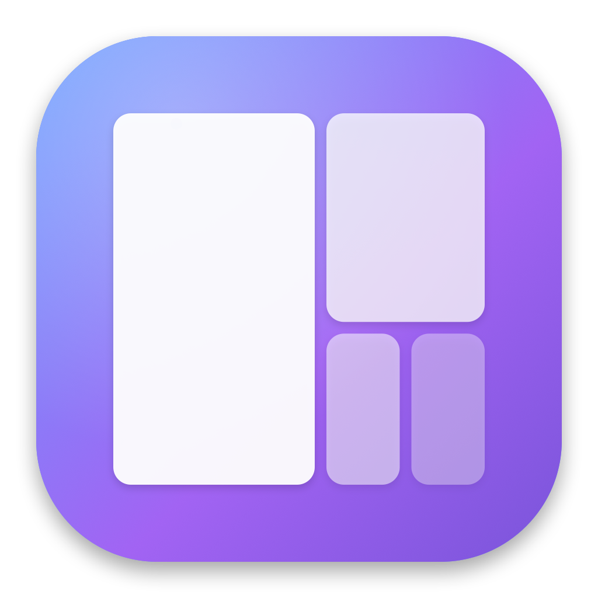
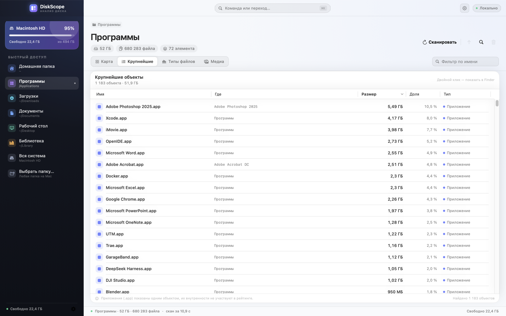
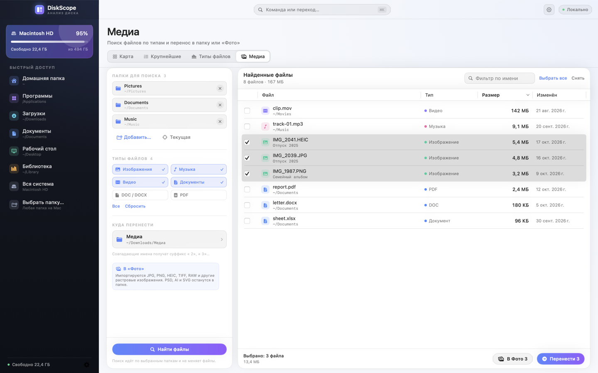
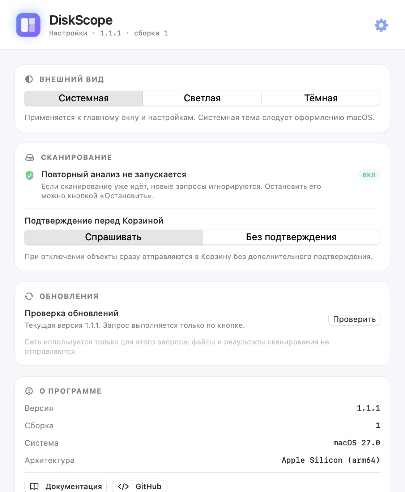

  

<h1 align="center">DiskScope</h1>

  <strong>Нативный анализатор диска для macOS.</strong> 
  Тепловая карта, крупнейшие файлы, типы, медиа-поиск и безопасная очистка.

  
  
  

  
  
  
  
  
  

---

## Что такое DiskScope

DiskScope — нативное приложение для macOS, которое показывает, **что именно занимает место на диске**. Оно сканирует выбранную папку или весь том, строит интерактивную тепловую карту и помогает перейти к крупнейшим объектам.

Приложение не отправляет файлы и результаты сканирования в сеть. Единственный сетевой запрос — проверка обновлений по кнопке в настройках.

## Что нового в 1.1.1

- **Настройки приложения** (`⌘,`): тема, подтверждение Корзины, сведения и проверка обновлений.
- **Проверка обновлений** через GitHub Releases: только вручную, с прямой ссылкой на DMG.
- **Защита от повторного анализа**: пока идёт сканирование, новый скан не запускается.
- **Кастомный DMG-лаунчер**: фирменный фон, стрелка и аккуратная раскладка иконок.
- **Кастомный title bar** в духе VS Code: нативные traffic lights, бренд, статус и палитра команд.
- 42 XCTest, включая сравнение версий и защиту от повторного скана.

Полная история — в [Changelog](Changelog).

## Возможности

| Возможность | Что делает |
| --- | --- |
| **Быстрый скан** | `getattrlistbulk` + `openat`, прогресс и отмена; миллионы файлов без лишней памяти |
| **Тепловая карта** | Двухуровневая squarified-карта; клик открывает папку, подсказки показывают размер и долю |
| **Крупнейшие объекты** | Файлы и приложения по размеру; `.app` считается одним объектом |
| **Типы файлов** | Видео, изображения, музыка, архивы, документы, код и другое |
| **Медиа-поиск** | Изображения, музыка, видео, документы, DOC/DOCX и PDF по выбранным папкам |
| **Очистка** | Finder и Корзина с подтверждением; дерево и суммы обновляются сразу |
| **Кастомное окно** | Нативные traffic lights, бренд, командная палитра `⌘K` и статус |
| **Настройки** | Тема, подтверждение Корзины, проверка обновлений и сведения |
| **Локальность** | Нет телеметрии; сеть — только для проверки обновлений по кнопке |
| **Universal** | Apple Silicon и Intel, macOS 14+ |

## Скриншоты

### Карта и крупнейшие объекты

### Медиа-поиск

### Настройки

## С чего начать

| Шаг | Страница |
| --- | --- |
| Установить DiskScope | [Установка](Installation) |
| Сделать первый скан | [Быстрый старт](Quick-Start) |
| Разобраться в возможностях | [Возможности](Features) |
| Найти медиа и перенести файлы | [Медиа-поиск](Media-Search) |
| Настроить приложение и обновления | [Настройки и обновления](Settings-and-Updates) |
| Решить проблему | [Решение проблем](Troubleshooting) |

## Требования

- macOS 14 Sonoma или новее;
- Apple Silicon или Intel;
- около 5 МБ для приложения и DMG;
- для защищённых папок — «Полный доступ к диску».

## Приватность

DiskScope читает метаданные файлов локально. Он не отправляет имена, содержимое или результаты сканирования. Сеть используется только для проверки обновлений через GitHub API по явной кнопке. Подробнее — [Приватность и безопасность](Privacy-and-Security).

## Ссылки

- [Сайт документации](https://fso13.github.io/DiskScope/)
- [GitHub](https://github.com/fso13/DiskScope)
- [Релизы](https://github.com/fso13/DiskScope/releases)
- [Issues](https://github.com/fso13/DiskScope/issues)
- [CHANGELOG](https://github.com/fso13/DiskScope/blob/main/CHANGELOG.md)
