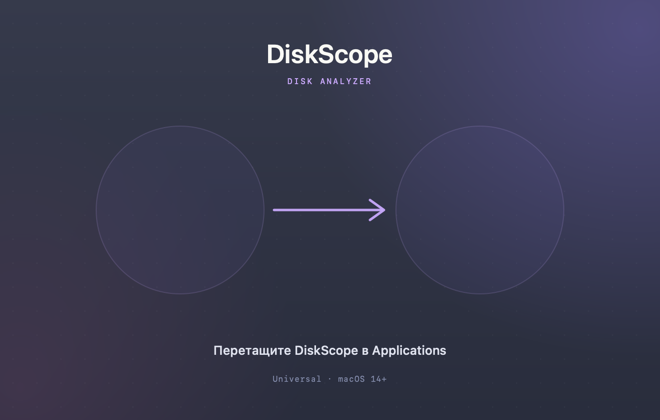

# Установка

## Системные требования

| Параметр | Значение |
| --- | --- |
| macOS | 14 Sonoma или новее |
| Архитектуры | Apple Silicon (arm64) и Intel (x86_64), universal |
| Приложение | `DiskScope.app` |
| Формат | DMG-установщик или ZIP-архив |
| Подпись | ad-hoc, без нотаризации |

## Установка из DMG

1. Скачайте [DiskScope-macos-universal.dmg](https://github.com/fso13/DiskScope/releases/latest/download/DiskScope-macos-universal.dmg).
2. Откройте образ.
3. Перетащите `DiskScope.app` в папку **«Программы»**.
4. Запустите DiskScope из «Программ».

Внутри образа используется кастомное оформление: `DiskScope.app` слева, `Applications` справа, стрелка между ними и фирменный фон с инструкцией. Панели Finder скрыты.

> **Совет.** Переместите приложение в «Программы» до выдачи разрешений: «Полный доступ к диску» и доступ к «Фото» привязаны к пути приложения.

## Если macOS не открывает приложение

DiskScope подписан ad-hoc и **не нотаризован**. Gatekeeper может показать предупреждение.

1. Нажмите на `DiskScope.app` в Finder с зажатой клавишей Control.
2. Выберите **«Открыть»**.
3. Подтвердите открытие.

Если приложение уже пыталось запуститься, можно открыть **Системные настройки → Конфиденциальность и безопасность** и нажать **«Всё равно открыть»**.

Это ожидаемое поведение для локальной сборки без Developer ID. Не отключайте Gatekeeper целиком.

## ZIP-архив

Если DMG не подходит:

1. Скачайте `DiskScope-macos-universal.zip` из [релизов](https://github.com/fso13/DiskScope/releases).
2. Распакуйте.
3. Переместите `DiskScope.app` в «Программы».
4. Запустите.

## Полный доступ к диску

Без разрешения macOS скрывает содержимое защищённых папок: `~/Library/Mail`, `~/Library/Messages`, Photos Library, домашние папки других пользователей и часть системных каталогов.

1. Переместите `DiskScope.app` туда, где он будет постоянно лежать.
2. Откройте **Системные настройки → Конфиденциальность и безопасность → Полный доступ к диску**.
3. Нажмите **+**, добавьте `DiskScope.app` и включите переключатель.
4. Перезапустите DiskScope и повторите сканирование.

Приложение продолжит работать без разрешения, но покажет баннер с количеством пропущенных объектов.

## Проверка установки

- В меню приложения откройте **«Настройки…»** (`⌘,`).
- Версия должна быть **1.1.1**, сборка — номер текущего релиза.
- В разделе «Обновления» доступна кнопка **«Проверить»**.

## Обновление

1. Откройте **Настройки → Обновления**.
2. Нажмите **«Проверить»**.
3. Если доступна новая версия, нажмите **«Скачать»** — откроется DMG последнего релиза.
4. Закройте DiskScope, замените приложение в «Программах» и запустите снова.

Настройки и «последняя папка» хранятся в UserDefaults и сохраняются при замене приложения.

## Удаление

1. Закройте DiskScope.
2. Переместите `DiskScope.app` в Корзину.
3. При необходимости удалите настройки через сброс в приложении.

DiskScope не устанавливает демонов, фоновых процессов и расширений.

## Дальше

- [Быстрый старт](Quick-Start)
- [Настройки и обновления](Settings-and-Updates)
- [Решение проблем](Troubleshooting)
